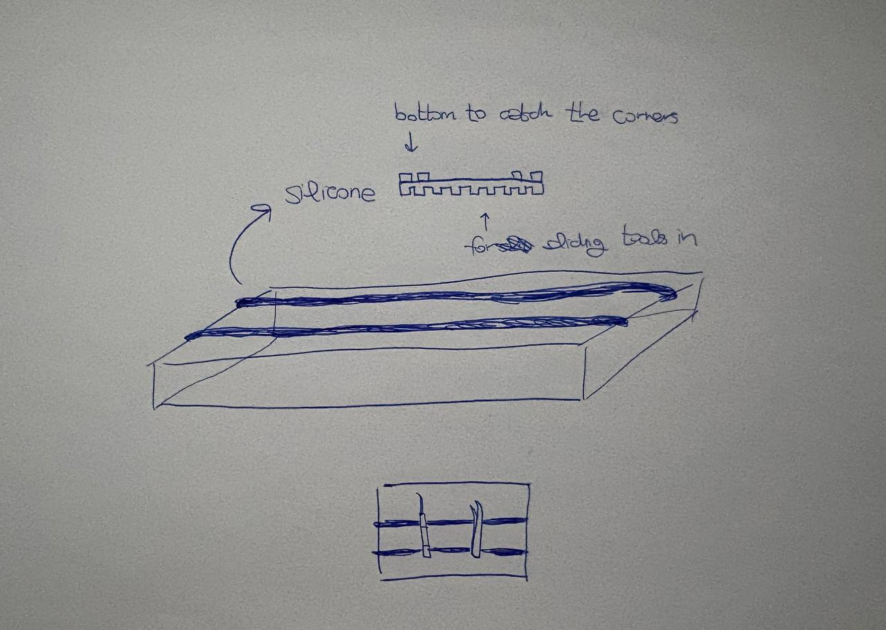
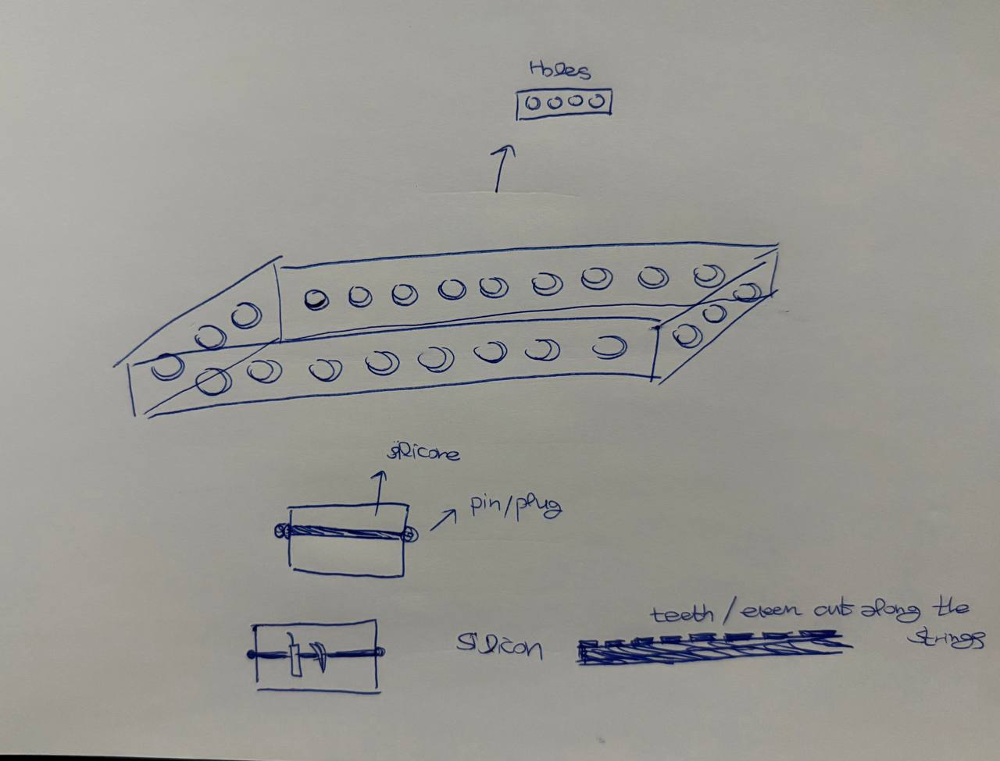
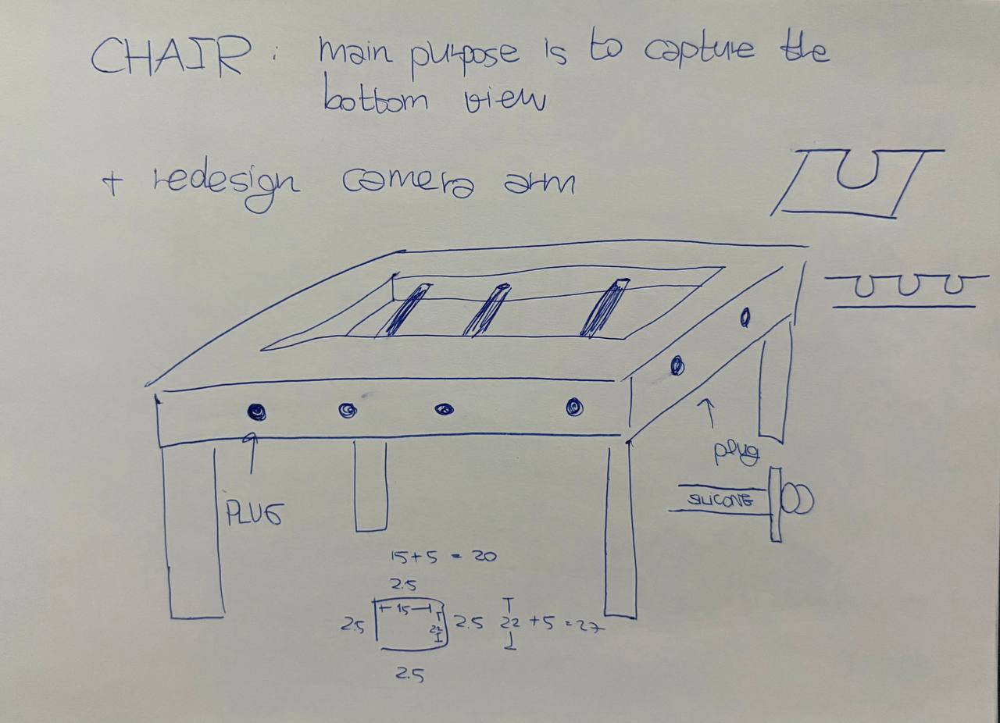
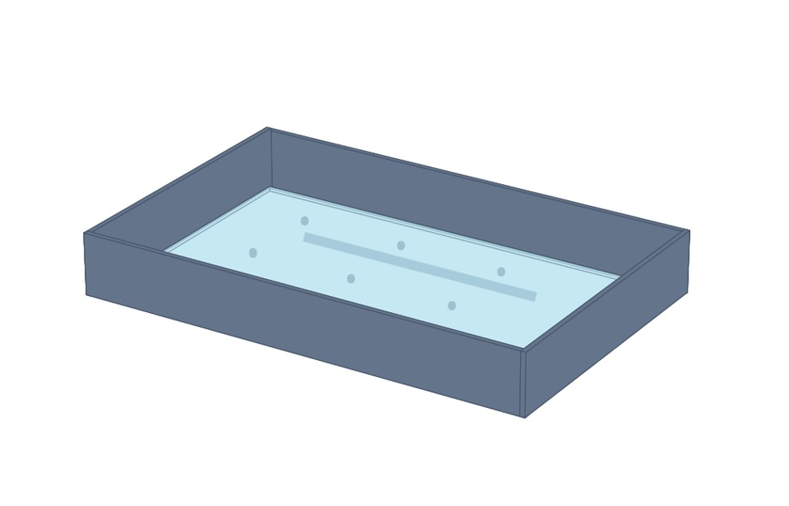
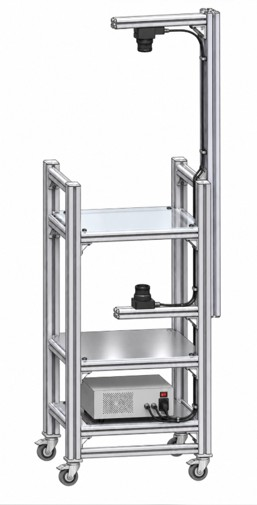
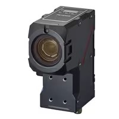
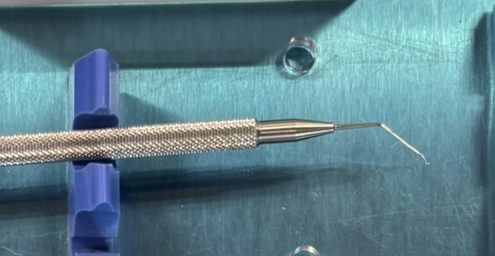
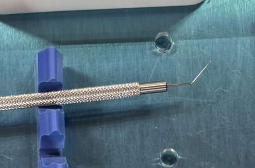
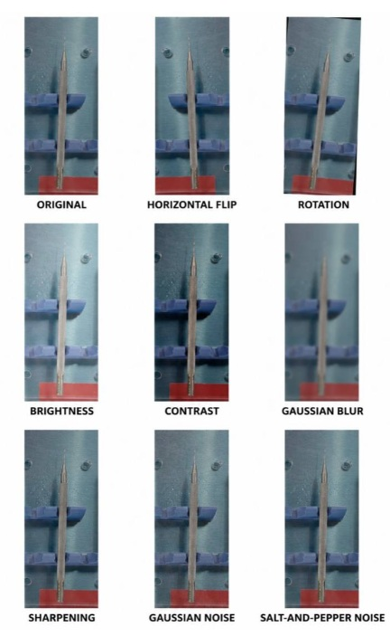

<h1>CDE4301 Interim Report</h1>

<b>Automated Inspection of Ophthalmic Surgical Tools</b>

In collaboration with the Singapore National Eye Centre (SNEC)

 

 

Project EIM-405: Automated Inspection of Ophthalmic Surgical Tools

 

<table>
  <thead>
    <tr>
      <th>Student Name</th>
      <th>Student No.</th>
    </tr>
  </thead>
  <tbody>
    <tr>
      <td>Wongmuang Napatsawan</td>
      <td>A0287748E</td>
    </tr>
    <tr>
      <td>Christoph Franz Cuan</td>
      <td>A0288302E</td>
    </tr>
  </tbody>
</table>

<b>Supervisor:</b> Mr. Nicholas Chew

 

---
<h2 align="center">Project Team</h2>

 

&nbsp;&nbsp;&nbsp;&nbsp;&nbsp;&nbsp;&nbsp;&nbsp;

  

<b>Napatsawan Wongmuang</b>
&nbsp;&nbsp;&nbsp;&nbsp;
<b>Christoph Franz Czuan</b>

  

Biomedical Engineering
&nbsp;&nbsp;&nbsp;&nbsp;&nbsp;&nbsp;&nbsp;&nbsp;
XX Engineering

---

---

# Acknowledgment 
We would like to express our sincere gratitude to our supervisor, Mr. Nicholas Chew, for his guidance, constructive feedback, and continued support through the semester. We also extend our appreciation to the Singapore National Eye Centre (SNEC) and the staff for facilitating our hospital visit and providing valuable insights into the clinical workflow and challenges associated with ophthalmic surgical instrument inspection. Finally, we would like to thank the NUS IDP Hub and Centralised Workshop for their technical assistance, facilities and support in the fabrication and production of our prototype components.

---

# Abstract
This interim report documents the development, improvement, and preliminary evaluation of an automated ophthalmic surgical-instrument inspection system developed with the Singapore National Eye Centre (SNEC). Building upon the inherited MEDetect project from the previous cohort with the two linked challenges in mind: acquiring more than one side of the tool images (2D) within a practical physical setup, and improving defect detection accuracy. Semester 1 development included alternative initial concepts of mechanical parts, a final prototype of a transparent-base tray and trolley design, and the training and development of defect detection using Mask R-CNN. The proposed operational camera is the Keyence VS-L160CX, while the machine learning development uses photographs from a handphone camera (iPhone 15). Comparative calculations examine the consequences of camera resolution and field of view for fine instrument tips will be demonstrated alongside an idealised cantilever analysis that estimates camera-arm deformation under assumed loading and stiffness. For the initial Hook Sinskey pilot happened in Semester 1, 226 original images were used for training, validation and test sets. Mask R-CNN among YOLO and DETRs achieved a reported 100% classification accuracy on 20 usable test crops while a full-pipeline accuracy fell to 83.3% across 24 test images, and its wet-condition accuracy was 66.7%. The results indicate promising crop-level defect classification but highlight unresolved limitations in localisation, wet-image robustness and transfer from smartphone to industrial-camera imaging. Semester 2 work will focus on Keyence-native training data, full integration of mechanical and machine learning systems, and the development of user interface for the seamless workflow in a real hospital setting. 
 

---

# Table of Contents

**Preliminary Sections**

- [Abstract](#abstract)
- [List of Figures](#list-of-figures)
- [List of Tables](#list-of-tables)
- [Acronyms](#acronyms)

**1. Introduction**

- [1.1 Clinical Context and Current Inspection Workflow](#11-clinical-context-and-current-inspection-workflow)
- [1.2 Problem Statement and Engineering Need](#12-problem-statement-and-engineering-need)
- [1.3 Project Objectives, Scope, and Value](#13-project-objectives-scope-and-value)

**2. System Requirements and Design Specifications**

- [2.1 Proposed System Overview](#21-proposed-system-overview)
- [2.2 Hardware Design Requirements](#22-hardware-design-requirements)
- [2.3 Software Design Requirements](#23-software-design-requirements)
- [2.4 Performance Specifications and Acceptance Criteria](#24-performance-specifications-and-acceptance-criteria)

**3. System Design and Prototype Development**

- [3.1 Mechanical Design Development](#31-mechanical-design-development)
  - [3.1.1 Initial Concepts and Evaluation](#311-initial-concepts-and-evaluation)
  - [3.1.2 Selected Design](#312-selected-design)
    - [3.1.2.1 Final Tray Design](#3121-final-tray-design)
    - [3.1.2.2 Three-Tier Trolley Design and Camera Arm](#3122-three-tier-trolley-design-and-camera-arm)

- [3.2 Imaging System Design and Feasibility](#32-imaging-system-design-and-feasibility)
  - [3.2.1 Proposed Keyence Camera Configuration](#321-proposed-keyence-camera-configuration)
  - [3.2.2 Comparative Optical Resolution Analysis](#322-comparative-optical-resolution-analysis)

- [3.3 Machine-Learning Prototype Development](#33-machine-learning-prototype-development)
  - [3.3.1 ML Architectures, Detection and Segmentation Paradigms](#331-ml-architectures-detection-and-segmentation-paradigms)
  - [3.3.2 Training Procedure and Dataset Preparation](#332-training-procedure-and-dataset-preparation)
  - [3.3.3 Prototype Testing and Performance Evaluation](#333-prototype-testing-and-performance-evaluation)
  - [3.3.4 Prototype Selection and Analysis](#334-prototype-selection-and-analysis)

**4. Discussion, Limitations and Semester 2 Plan**

- [4.1 Interpretation and Limitations](#51-interpretation-and-limitations)
- [4.2 Prioritised Semester 2 Milestones](#52-prioritised-semester-2-milestones)

**5. Conclusion**

- [Conclusion](#6-conclusion)

**References and Appendices**

- [References](#references)
- [Appendix A: Existing Surgical Tray](#appendix-a-existing-surgical-tray)
- [Appendix B: Final Tray Design](#appendix-b-final-tray-design)
- [Appendix C: Trolley Prototyping](#appendix-c-trolley-prototyping)
- [Appendix D: Semester 2 Development Gantt Chart](#appendix-d-semester-2-development-gantt-chart)

---
## List of Figures

- [Figure 1. Initial tray concept using suspended silicone strips](#figure-1)
- [Figure 2. Initial tray concept using a perforated frame and adjustable silicone strings](#figure-2)
- [Figure 3. Initial elevated open-bottom tray concept](#figure-3)
- [Figure 4. CAD rendering of the proposed surgical instrument tray](#figure-4)
- [Figure 5. Final Trolley Assembly](#figure-5).

## List of Tables
XX

---

# Acronyms

| Acronym | Definition |
|:--------|:-----------|
| SNEC | Singapore National Eye Centre |
| HS | Hook Sinskey |
| CP | Chop Phaco |
| FM | Forceps Macpherson |
| FU | Forceps Utrata |
| FNR | False-negative Rate |
| DETR | Detection Transformer |
| YOLO | You-Only-Look-Once |
| M6 | Metric fastener with nominal 6 mm thread diameter |

---
# 1 Introduction

## 1.1 Clinical Context and Current Inspection Workflow

The inspection of ophthalmic surgical instruments at the Singapore National Eye Centre (SNEC) remains largely manual, requiring nurses to examine tools at multiple stages before and after surgery and during reprocessing. With over 21,000 cataract procedures annually at the SNEC (SNEC, n.d.) and approximately four inspection checkpoints per procedure or an estimated 84,000 inspections are performed each year. Although tray inspection and counting typically take only one to two minutes, these repetitive tasks add to nurses’ workload and may contribute to inconsistent assessments due to fatigue, varying lighting conditions and subjective judgement. Furthermore, preliminary measurements conducted by the previous MEDetect project team under a microscope identified ophthalmic instrument tip dimensions ranging from approximately 0.18 to 0.42 mm, highlighting the difficulty of identifying subtle defects such as bending, chipping and micro-fractures. These challenges are supported by studies reporting residual debris in nearly two-thirds of reprocessed ophthalmic surgical trays (Dinakaran & Kayarkar, 2002) and foreign material or structural abnormalities in over half of examined ophthalmic handpieces (Zhan et al., 2025). Together, these findings highlight the need for a more consistent and efficient inspection system that supports clinical staff without replacing their professional judgement.

## 1.2 Problem Statement and Engineering Need

e

## 1.3 Project Objectives, Scope, and Value

This project aims to create a tray-compatible automated inspection aid combining opposing-view imaging with a computer-vision pipeline. Initial algorithmic evaluation focused on the Hook Sinskey (HS) with the chance of future extension including Chop Phaco and Macpherson, and Utrata forceps. The envisioned system counts or localises instruments, evaluates visible damage and flags abnormal or uncertain outcomes for nurse review. It is not intended to replace clinical judgement or independently approve instruments for reuse. The anticipated contribution lies in joining a practical optical-mechanical fixture to defect-focused image analysis rather than improving a model score in isolation.

| **Value proposition** | **Rationale and intended contribution** |
|:---|:---|
| **More consistent defect screening** | The same trained models apply to every tray, reducing variation caused by fatigue, workload, and individual judgement. |
| **Identification of subtle damage** | The model evaluates fine contours, enabling focused analysis of features such as bent, chipped or partially broken tips. |
| **Better use of skilled nursing time** | Automating repetitive screening and instrument counting is intended to reduce routine inspection demands, allowing nurses to focus on clinical judgement and cases requiring further review. |
| **Transparent and auditable decisions** | The proposed workflow prioritises interpretable inspection results, including tool identification, defect classifications and confidence information, while retaining human verification of uncertain findings. |
| **Robustness under realistic inspection conditions** | Since ophthalmic instruments may be wet, reflective or positioned differently during inspection, these conditions are prioritised in prototype evaluation to assess the system's suitability for clinical use. |

<em>Table 1. Value Proposition</em>

---

## 2.1 Proposed System Overview

The proposed workflow is: **tray positioning → image capture → tool localisation/counting → cropped detail analysis → reviewed result.**

The proposed system was developed to address two limitations of the inherited MEDetect project: the inability to inspect both sides of surgical instruments without manual repositioning and inconsistent defect detection. To address these challenges, the team proposed a transparent-base tray with cameras positioned above and below the instruments. This arrangement aims to improve surface visibility while minimising additional handling by nurses. The inspection process also retains two stages: instrument localisation and counting, followed by detailed defect assessment. This approach was selected because identifying entire instruments and examining fine defects require different levels of image detail.

## 2.2 Hardware Design Requirements

Hardware requirements were established by considering clinical workflow compatibility and imaging consistency. The team prioritised maintaining dimensions similar to the existing SNEC surgical tray to minimise changes to instrument handling and placement. The tray specifications and photographs of the existing tray are provided in Appendix A for reference.

A transparent base was selected to permit imaging from below, while a modular aluminium trolley with a top clear acrylic tier was proposed to support the opposing cameras. Since even small changes in camera positioning may affect image focus and repeatability, mounting stability was identified as an important design consideration alongside optical resolution and field of view.

## 2.3 Software Design Requirements

Given these contextual considerations, the following design specifications were established as target objectives for addressing the identified use cases and pain points. In lieu of a Singapore precedent, numeric targets were informed by the FDA-cleared IDx-DR autonomous AI system, which evaluates ophthalmic images for diabetic-retinopathy screening and reported 87.2% sensitivity and 90.7% specificity (Abràmoff et al., 2018). However, since the proposed system screens surgical instruments as opposed to producing diagnoses, the project establishes stricter ideal-case performance targets than the IDx-DR benchmark.

## 2.4 Performance Specifications and Acceptance Criteria

The resulting design specifications are presented in Table 2, together with their proposed verification methods. Numerical targets were established to guide prototype evaluation, with particular emphasis on minimising false negatives and maintaining practical inspection times. These specifications represent the team's intended performance criteria rather than confirmed achievements, providing a basis for identifying limitations and planning further verification in Semester 2.

| **Design requirement** | **Target** | **Engineering rationale** | **Verification method** |
|:---|:---|:---|:---|
| **Inspection time** | ≤60 s per tray | Reduce processing time compared with the current 1–2-minute manual inspection. | Measure total time from image capture to displayed results. |
| **Defect detection** | FNR ≤5% | Prioritise minimising missed defects due to potential patient-safety consequences. | Evaluate against labelled defective instruments. |
| **Instrument counting** | ≥95% accuracy | Support reliable verification of instrument presence during tray preparation. | Compare predicted counts with actual tray contents. |
| **Wet-condition performance** | Sensitivity ≥90%; FNR ≤10% | Assess performance when moisture and reflections affect instrument visibility. | Evaluate using a separate wet-image test set. |
| **Human verification** | All positive and uncertain cases reviewed | Retain clinical judgement for potentially defective instruments. | Verify that flagged results require user review. |
| **Camera-arm stability** | To be established in Semester 2 | Minimise camera movement that could affect image consistency and focus. | Measure and calculate loaded displacement. |
| **Optical resolution** | Smallest relevant defect must be distinguishable | Ensure sufficient image detail for detecting fine instrument damage. | Calibrate field of view and measure image sampling. |

<em>Table 2. Acceptance Criteria</em>

---

# 3 System Design and Prototype Development

## 3.1 Mechanical Design Development

### 3.1.1 Initial Concepts and Evaluation

Three initial tray-support concepts were explored to improve visibility of the underside of ophthalmic surgical instruments while maintaining secure instrument placement. The first concept (Figure 1) used suspended silicone strips to support the instruments while leaving spaces for imaging from below. The second concept (Figure 2) introduced a perforated frame with adjustable silicone strings, allowing greater flexibility in positioning the supports. However, both concepts would still require nurses to flip the tray to inspect the opposite surface, limiting their potential to reduce manual handling.

To address this limitation, the third concept (Figure 3) introduced an elevated, open-bottom tray supported by legs. Unlike the first two designs, this arrangement would allow a camera to be positioned underneath the instruments without flipping the tray. Nevertheless, the open support structures raised concerns about instrument stability, ease of placement and the possibility of additional instrument damage. These considerations subsequently guided the selection of a transparent-base tray, which aims to provide underside visibility while retaining a continuous support surface.

  
   
  <em>Figure 1. Initial tray concept using suspended silicone strips.</em>

  
   
  <em>Figure 2. Initial tray concept using a perforated frame and adjustable silicone strings.</em>

  
   
  <em>Figure 3. Initial elevated open-bottom tray/chair concept.</em>

### 3.1.2 Selected Design

#### 3.1.2.1 Final Tray Design

The existing SNEC tray was measured at approximately 277 mm × 177 mm in external footprint and 37 mm in height. The proposed tray follows these overall dimensions, using a laser-cut acrylic base and 3D-printed surrounding walls as illustrated in Figure 4. The acrylic is intended to permit imaging from below, while printing the walls makes it easier to modify the frame during prototyping. CAD drawings of the components and photographs of the fabricated tray are provided in [Appendix B](#appendix-b-final-tray-design).

The final component fit, surface quality and any optical distortion caused by the acrylic still require further assessment for clinical compliance, as the design is intended for proof-of-concept testing and has not been established as suitable for sterile clinical use.

  
   
  <em>Figure 4. CAD rendering of the proposed surgical instrument tray with a transparent acrylic base and 3D-printed surrounding walls.</em>

#### 3.1.2.2 Three-Tier Trolley Design and Camera Arm

The trolley consists of 3030 T-slot aluminum extrusions arranged across three tiers, as illustrated in Figure 5. The upper tier accommodates the transparent tray and imaging area, while the second and third tiers provide less noisy background in images and a space for power unit storage, respectively.

Two cameras are proposed, with one positioned above the tray and the other underneath the transparent base and facing up. This opposing arrangement aims to capture both sides of the instruments without requiring manual flipping.

Photographs of the fabricated trolley and the bill of materials used for fabrication at the NUS Central Workshop are provided in [Appendix C](#appendix-c-trolley-prototyping).

  
   
  <em>Figure 5. Final Trolley Assembly.</em>

The current camera-arm design uses a horizontal aluminium extrusion approximately 270 mm long, connected to a vertical support through a right-angle bracket. The proposed mounting plate measures 200 × 100 × 3 mm and uses M6 fasteners. Since camera positioning affects both the field of view and image repeatability, a preliminary static calculation was conducted before physical stability testing.

Using the manufacturer's specified mass of approximately 0.70 kg for the KEYENCE VS-L160CX camera ([KEYENCE Corporation, n.d.](https://www.keyence.com.sg/products/vision/vision-sys/vs/models/vs-l160cx/)), an aluminium plate density of 2,700 kg/m³ and the nominal plate dimensions, the estimated plate mass is:

**Plate mass:**

m = ρV = 2,700 × (0.200 × 0.100 × 0.003) = **0.162 kg**

**Combined gravitational load:**

F = (0.700 + 0.162) × 9.81 = **8.46 N**

**Estimated bending moment at the arm joint:**

M = FL = 8.46 × 0.270 = **2.28 N·m**

If the arm is idealised as a fully fixed cantilever, with an assumed aluminium Young's modulus of E = 69 GPa and an illustrative profile second moment of area of I = 3.0 × 10⁻⁸ m⁴, the beam-tip deflection is estimated using:

**δ = FL³ / (3EI)**

δ = [8.46 × (0.270)³] / [3 × (69 × 10⁹) × (3.0 × 10⁻⁸)]

**δ ≈ 0.0268 mm**

This preliminary estimate assumes a fully fixed connection and an equivalent point load at the end of the arm. It does not account for bracket flexibility, joint compliance or differences in component centres of mass. Semester 2 verification will therefore measure camera-arm displacement and image repeatability under load, using the idealised aluminium-beam calculation as a reference.

## 3.2 Imaging System Design and Feasibility

Although the inherited MEDetect system used a KEYENCE VS-L160CX camera, the team selected the iPhone 15 for preliminary image acquisition because it allowed greater flexibility in collecting training images under different lighting, instrument-placement and wet–dry conditions without requiring a completed mechanical setup, as the physical setup was still under construction.

Nevertheless, the KEYENCE camera remains the proposed imaging device for the integrated system (Figure 6). Unlike the smartphone, it is an industrial machine-vision camera designed for controlled inspection applications. Although its nominal pixel count is lower than that of the iPhone 15, its industrial imaging capabilities and compatibility with a fixed inspection setup make it a suitable candidate for further evaluation.

  
   
  <em>Figure 6. KEYENCE VS-L160CX camera.</em>

### 3.2.1 Proposed KEYENCE Camera Configuration

The inherited KEYENCE VS-L160CX camera (Figure 6) was retained for the proposed inspection system because its integrated zoom lens and adjustable imaging settings allow controlled image acquisition within the fixed trolley configuration, while maintaining continuity with the previous MEDetect project.

### 3.2.2 Comparative Optical Resolution Analysis

As ophthalmic instruments have fine tips measuring approximately 0.18–0.42 mm, the imaging configuration must provide sufficient detail for defect assessment. While the KEYENCE VS-L160CX has a lower pixel count (1.6 MP) than the iPhone 15 used for preliminary data collection (KEYENCE Corporation, n.d.), the team recognised that image detail also depends on the field of view (FOV). A smaller FOV allows an instrument feature to occupy more pixels, although it reduces the area captured in a single image.

To assess this relationship, a preliminary spatial-sampling calculation was performed using the horizontal FOV (*W*) and image width (*N*):

  <strong>s = W / N</strong>

Where:

- **s** = spatial sampling (mm/pixel)
- **W** = horizontal field of view (mm)
- **N** = horizontal image resolution (pixels)

Assuming both cameras capture the full 277 mm tray width, the KEYENCE provides an estimated 0.1924 mm/pixel, compared with 0.03435 mm/pixel for an illustrative 48 MP iPhone image. These calculations highlight the need to balance tray coverage with fine-feature visibility when determining the final imaging configuration. The estimates will be verified through optical calibration using the KEYENCE camera in Semester 2.

| **Imaging configuration** | **Horizontal pixels** | **Assumed FOV** | **Spatial sampling** |
|:---|---:|---:|---:|
| KEYENCE VS-L160CX (1.6 MP) | 1,440 | 277 mm | 0.1924 mm/pixel |
| iPhone 15 (illustrative 48 MP mode) | 8,064 | 277 mm | 0.03435 mm/pixel |

## 3.3 Machine-Learning Prototype Development

Due to the manpower limitations of a two-person team, this project focused on one target instrument: the **Hook Sinskey (HS)**. This allowed the team to collect, annotate, train and evaluate a sufficiently controlled dataset instead of attempting to develop shallow models for all tool types.

Hook Sinskey (HS) was selected as the initial pilot tool because the inherited YOLO defect-detection model achieved an mAP50–95 (mean Average Precision) of 57.1%. This metric measures how closely predicted bounding boxes overlap the ground-truth defect regions across ten increasingly strict thresholds, from 0.50 to 0.95. The result indicated moderate performance: the model was neither close to saturation, where further improvement would be difficult to demonstrate, nor so weak that performance differences could primarily reflect poor data quality or unreliable labels.

### 3.3.1 ML Architectures, Detection and Segmentation Paradigms

Two alternative architectures with potential to perform better on surgical-tool defect detection were explored. The first is DETR, an architecture using transformer encodings capable of performing object detection and instance segmentation. The second is Mask R-CNN, a two-stage instance-segmentation model. These models were considered because prior studies show that both can perform well on medical imaging tasks. For instance, DETR achieved 97% sensitivity for lesion detection in a multicentre liver-ultrasound study (Dadoun, 2022), while Mask R-CNN scored above 93% in detecting post-trabeculectomy blebs (Wang et al., 2020).

These models comprise two detection paradigms which were tested to identify an optimal model performance balancing both inference speed and prediction accuracy. The first is detection, which predicts a bounding box around an image component and assigns a label, such as defective or non-defective. This generally provides faster inference time but may not explicitly capture fine contours, tool-tip geometry or the exact location of a defect. The second is segmentation, which predicts a pixel-level mask for each object, capturing precise tool boundaries but generally comes with higher computational costs and inference times.

Four prototypes were therefore developed:

| **Prototype** | **Model** | **Output paradigm** |
|:---|:---|:---|
| Prototype 0 | YOLO defect detection | Bounding-box detection |
| Prototype 1 | DETR detection | Bounding-box detection |
| Prototype 2 | DETR segmentation | Pixel-level instance segmentation |
| Prototype 3 | Mask R-CNN | Pixel-level instance segmentation |

### 3.3.2 Training Procedure and Dataset Preparation

To train the model prototypes to predict defect conditions, a dataset containing images of both defective and non-defective instruments was collected. Images were acquired using an iPhone 15 with a 48-megapixel camera under varied instrument-placement and wet–dry conditions to facilitate rapid proof-of-concept development.

To simulate wet conditions, both the instrument and tray surfaces were sprayed with water to represent post-operation and post-washing conditions. For lighting, room blinds were closed and LED illumination was used to simulate hospital lighting conditions, using artificial rather than natural light. The resulting dataset contained both defective and non-defective Hook Sinskey samples, as illustrated in Figures 7 and 8.

  
   
  <em>Figure 7. Defective Hook Sinskey sample.</em>

  
   
  <em>Figure 8. Non-defective Hook Sinskey sample.</em>

Subsequently, images were manually labelled according to their relevant classes. Detection models used defect bounding-box annotations, while segmentation models used corresponding pixel-level masks.

After manual labelling was completed, the dataset was divided into training, validation and test sets. A larger training portion allowed the models to learn defect patterns, while the validation and test sets were retained for model tuning and unbiased performance evaluation. The approximate split was 70% training, 20% validation and 10% testing.

| **Split** | **Original images** | **Augmented images** | **Total files** | **Defective** | **Healthy** |
|:---|---:|---:|---:|---:|---:|
| Training | 161 | 161 | **322** | 216 | 106 |
| Validation | 41 | 0 | 41 | 30 | 11 |
| Test | 24 | 0 | 24 | 16 | 8 |

To improve generalisation without contaminating the evaluation data, augmentation was applied only to the training set, following a 50:50 original-to-augmented policy. The augmentation methods and their corresponding settings are presented below, with representative examples shown in Figure 9.

| **Augmentation** | **Setting** |
|:---|:---|
| Horizontal flip | 50% probability |
| Rotation | Up to ±10° |
| Brightness adjustment | ±15% |
| Contrast adjustment | ±15% |
| Gaussian blur | 10% probability |
| Sharpening | 10% probability |
| Gaussian noise | 15% probability; σ = 0.015 |
| Salt-and-pepper noise | 5% probability; 0.2% of pixels |

  
   
  <em>Figure 9. Representative image augmentation techniques applied to the training dataset.</em>

  
---

# 4 Discussion, Limitations and Semester 2 Plan

## 4.1 Interpretation and Limitations

The Semester 1 work established a proposed mechanical setup and evaluated preliminary defect-detection models.

The transparent-base tray and opposing-camera arrangement were developed to improve visibility of both instrument surfaces while reducing manual handling for flipping. However, although the tray and trolley components have been fabricated, the complete system has not yet been tested with the KEYENCE camera(s). Therefore, the suitability of the acrylic sheets for imaging, the stability of the camera supports and the repeatability of image acquisition remain unverified. The preliminary optical and structural calculations provide initial estimates but rely on assumed imaging conditions and mechanical properties.

Furthermore, the ML models were trained and evaluated using iPhone 15 images, meaning their performance may change when images are acquired using the intended KEYENCE camera. Although Mask R-CNN demonstrated promising defect-classification results, its performance remains dependent on successful tool localisation and was weaker under wet conditions. These limitations highlight the need for integrated hardware testing, optical calibration and further model validation in Semester 2.

## 4.2 Development and Verification Plan

Semester 2 will focus on integrating the mechanical and imaging components into a functional inspection system. The KEYENCE cameras will first be installed on the fabricated trolley, followed by mechanical stability testing and optical verification through the acrylic tray. Once consistent imaging conditions have been established, additional Hook Sinskey images will be collected to support model retraining and validation.

User-interface development will proceed alongside detection system refinement before the components are integrated for end-to-end testing. Final verification will assess the system against the proposed design specifications, including defect detection, instrument counting and inspection time. The proposed development timeline is presented in [Appendix D](#appendix-d-semester-2-development-gantt-chart).

---

---

# 5 Conclusion

The Semester 1 development established a foundation for an automated ophthalmic surgical-instrument inspection system through both **mechanical design and machine-learning development**. By evaluating alternative tray concepts, the team developed a transparent-base tray and three-tier trolley configuration intended to support two-sided inspection with minimal instrument handling. Preliminary engineering calculations also provided further considerations for camera positioning and imaging requirements, and comparative ML testing identified Mask R-CNN as the preferred model for the initial Hook Sinskey application.

Together, these developments demonstrate progress towards integrating image acquisition with the physical setup and automated defect assessment into a single inspection workflow, providing a basis for continued system development in Semester 2.
